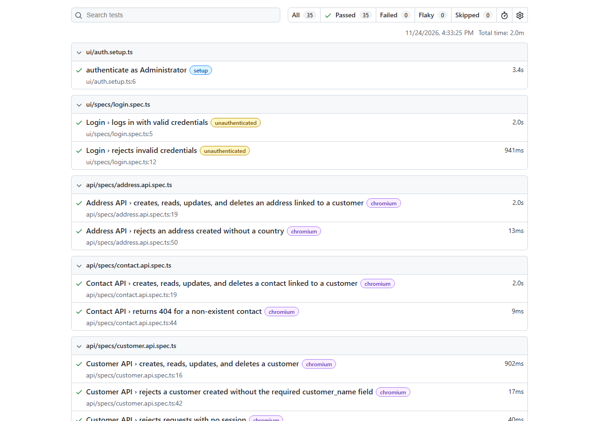
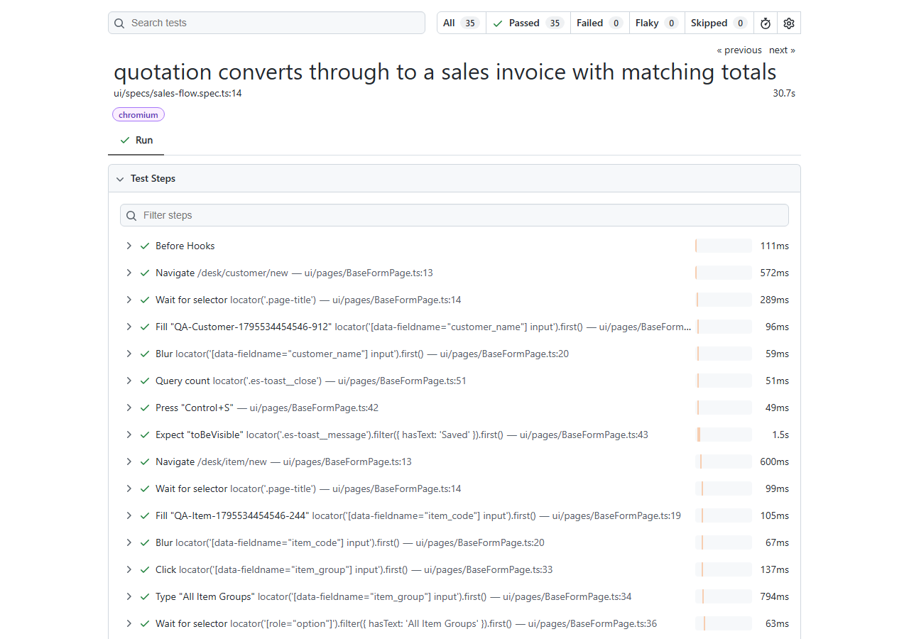

# ERPNext QA Automation Portfolio

Functional **UI** and **API** test automation suite for [ERPNext](https://github.com/frappe/erpnext), built with **Playwright + TypeScript**. The System Under Test is a local ERPNext instance stood up via [`frappe_docker`](https://github.com/frappe/frappe_docker)'s single-file demo setup (`pwd.yml`).

**35 tests, 100% passing** — 10 UI specs (Page Object Model) across Sales (Customer → Item → Quotation → Sales Order → Sales Invoice, including submit/cancel), HR (Employee), form validation, login, and global search; 25 API specs (CRUD + negative cases) across Customer, Item, Sales Order, Sales Invoice, Quotation, Employee, Contact, Address, and generic list-query filters.



<details>
<summary>Step-by-step trace of the flagship end-to-end sales flow</summary>



</details>

## What this demonstrates

- **End-to-end UI automation** of a real multi-step business workflow (Customer → Item → Quotation → Sales Order → Sales Invoice), using the **Page Object Model** for maintainability.
- **API-level testing** of Frappe's REST API (CRUD + negative cases) with Playwright's `APIRequestContext`.
- **Playwright project dependencies**: a dedicated `setup` project authenticates once and shares storage state across tests, while the `login.spec.ts` suite intentionally runs unauthenticated to exercise the login flow itself.
- **CI pipeline** (GitHub Actions) that is fully self-contained: it clones `frappe_docker`, boots ERPNext in Docker, waits for readiness, runs the full suite, and publishes the HTML report as a build artifact.

## Project structure

```
tests/
├── ui/
│   ├── pages/        # Page Object Model classes (one per ERPNext doctype/form)
│   ├── specs/         # UI test specs
│   └── auth.setup.ts  # Logs in once, saves storage state for the "chromium" project
└── api/
    ├── helpers/       # API client (session-based login auth)
    └── specs/         # API test specs (CRUD + negative cases)
fixtures/              # Test data factories (unique names per run)
```

## Running the SUT (ERPNext)

```sh
git clone https://github.com/frappe/frappe_docker
cd frappe_docker
docker compose -f pwd.yml up -d
```

Wait a couple of minutes for the `create-site` container to finish, then confirm `http://localhost:8080` loads (login: `Administrator` / `admin`). A brand-new site lands on ERPNext's one-time **Setup Wizard**; `tests/ui/auth.setup.ts` detects and completes it automatically (minimal company details) so the rest of the suite always has a ready site to run against.

## Running the tests

```sh
npm install
npx playwright install --with-deps chromium
cp .env.example .env   # defaults already match the SUT above
npx playwright test
npx playwright show-report
```

Run just one suite with `npm run test:ui` or `npm run test:api`.

## CI

`.github/workflows/tests.yml` runs on every push/PR: it clones `frappe_docker` fresh, starts ERPNext in Docker, polls `/api/method/ping` until the site is ready, runs the full Playwright suite, and uploads `playwright-report/` as a downloadable artifact — green end-to-end with no external dependencies or pre-existing credentials.

## Design notes

- **Why Page Object Model**: ERPNext's desk UI reuses the same form/grid interaction patterns across doctypes (`BaseFormPage`), so new doctype coverage (e.g. a Delivery Note flow) only needs a thin subclass, not new low-level DOM handling.
- **Why session-login for API auth**: a static API key/secret wouldn't exist on a freshly created site (CI creates a new one every run), so tests authenticate via `/api/method/login` instead, which works identically against any fresh instance.
- **Selectors**: ERPNext form fields expose stable `[data-fieldname="..."]` attributes natively — no app modification or custom `data-testid` patching required. This ERPNext version's desk is a redesigned SPA: it lives at `/desk` (not the older `/app`), confirms saves/submits via toast notifications (`.es-toast__message`) rather than a status pill, and renders dropdowns/menus via ARIA roles (`role="option"`, `role="menuitem"`) instead of Bootstrap classes — the Page Objects target these directly.
- **Dates**: fixtures (`fixtures/testData.ts`) generate ISO (`YYYY-MM-DD`), since that's what the REST API expects; `BaseFormPage.fillDate` converts to this site's display format (`DD-MM-YYYY`) before typing into a UI field. Keep that conversion in mind if the site's locale changes.

## Known limitation: HR flow is Employee-only

ERPNext moved Leave Application, Attendance, and the rest of HR/Payroll into a separate **HRMS** app in recent releases. This stack runs ERPNext v16.60.0, and the current HRMS release requires Frappe/ERPNext **v17+** — installing it here fails with a module-import error (`erpnext.accounts.doctype.sales_invoice.services` doesn't exist in v16). `tests/ui/specs/hr-flow.spec.ts` is scoped to **Employee** (which stayed in core ERPNext) for that reason. Extending to Leave Application/Attendance only requires upgrading the stack to an ERPNext v17 + HRMS combination and adding `LeaveApplicationPage`/`AttendancePage` (same `BaseFormPage` pattern as everything else).

## Possible extensions

- Upgrade the SUT to ERPNext v17 + HRMS and restore the Leave Application/Attendance flow.
- Allure reporting instead of/alongside the built-in HTML report.
- Manual test case matrix and exploratory test session notes, for a full QA-process writeup.
