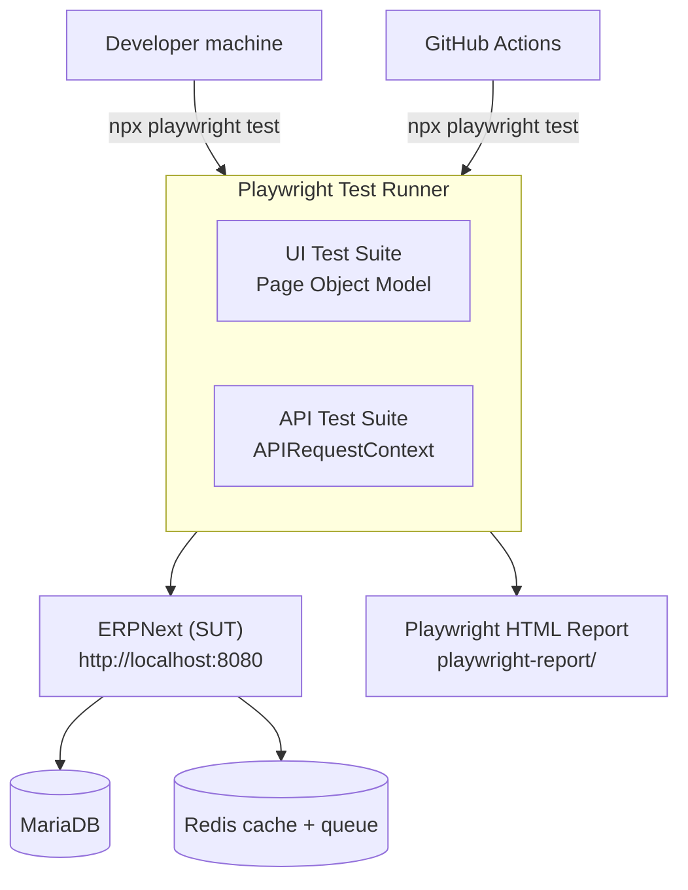
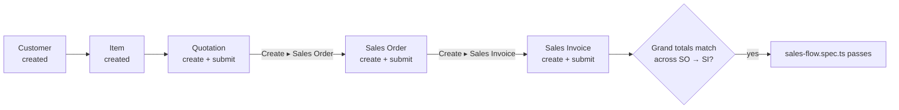
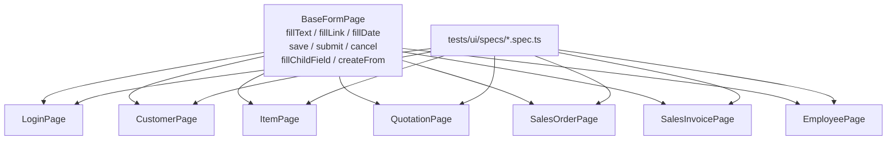
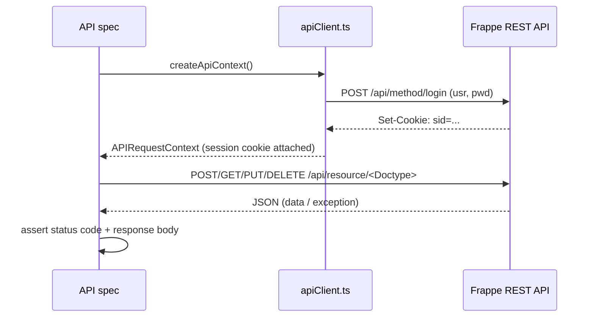
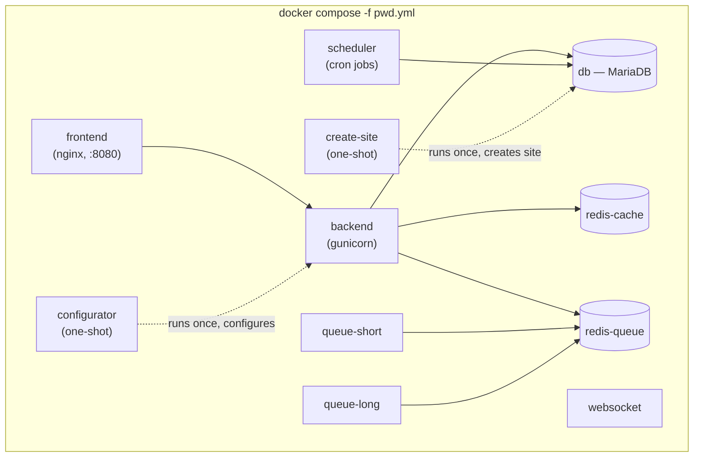
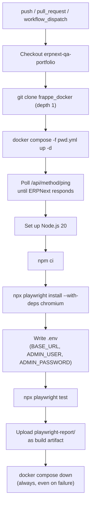
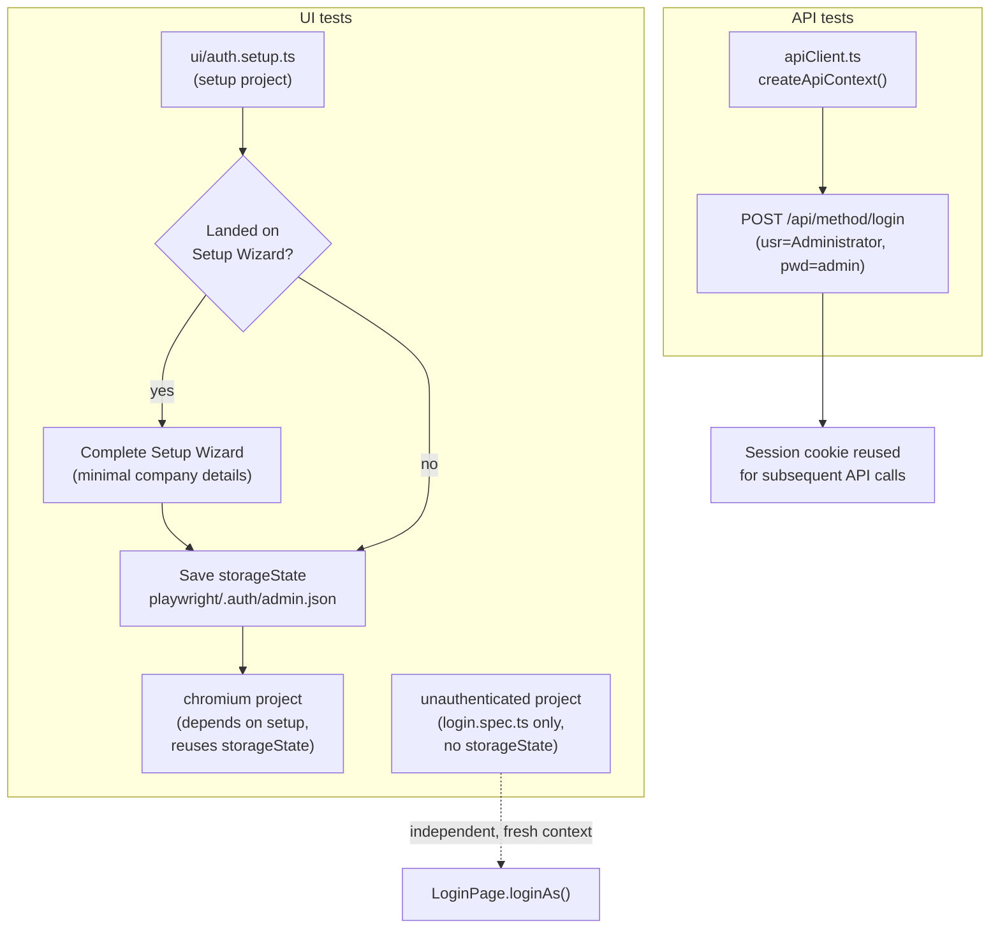

# Architecture Diagrams

Source-of-truth versions of every diagram embedded in the main README, kept here so they can be reviewed/edited independently of the README's layout. All diagrams reflect the actual implementation in this repository, not an idealized target.

## 1. Overall test automation architecture

## 2. End-to-end business workflow (Order-to-Cash)

## 3. UI automation architecture (Page Object Model)

## 4. REST API testing workflow

## 5. Docker test environment (frappe_docker `pwd.yml`)

## 6. GitHub Actions CI/CD pipeline

## 7. Authentication and session management

